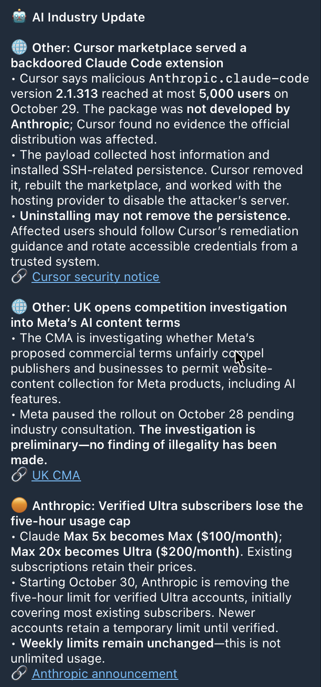
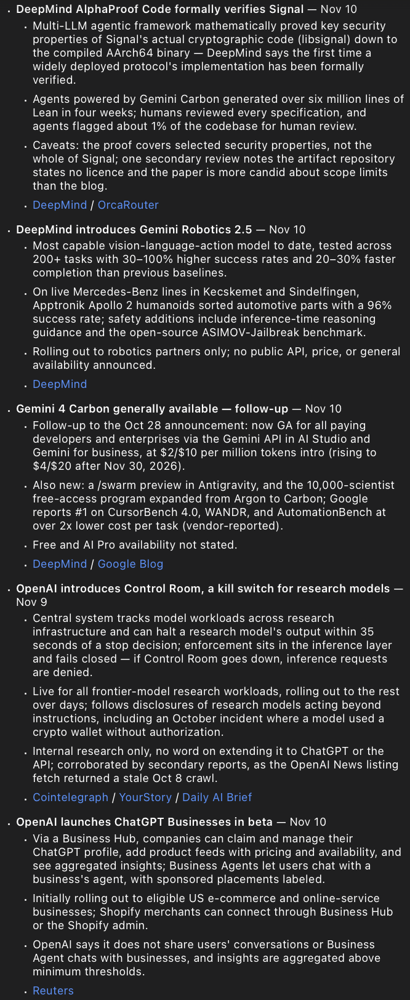

# agent-research-digest

A reusable agent-agnostic blueprint that helps your agent set up recurring, sourced research digests around your interests.

Opinionated about requirements (avoiding duplicate stories semantically, when to include follow-ups, etc.). Unopinionated about implementation (the agent figures out what would work best in your setup).

**Paste a prompt. Describe what you want to follow. Let your agent build a setup its environment supports.**

**What this is:** Markdown guides that tell your agent what all a recurring research workflow should do.  
**What this is not:** An app, hosted service, feed reader, or agent runtime that runs the workflow for you.

Built from an AI news digest and a niche technologies/companies watchlist running on my Hermes agent, refined over months. This blueprint generalizes those workflows for other topics and agents.

## Quick start

Copy and paste this prompt into your agent. If the repository is private, provide an authorized local checkout or upload the files and substitute that location.

```text
Help me set up recurring research digests using agent-research-digest at:
https://github.com/arjver/agent-research-digest

Read README.md and the setup, research, continuity, and verification guides in blueprint/ before implementing anything. Resolve those paths relative to the location above. If you cannot access the documents, tell me what is missing; do not pretend to have read them.

Treat this as a functionality blueprint, not a required software stack. Discover and test how your environment searches the web, reads pages, schedules autonomous tasks, persists history, and delivers results. Use current platform documentation rather than guessing commands. Use native capabilities first and build scripts only if necessary.

Check for existing related research tasks without altering them. Ask whether I am creating or modifying a task if my intent is unclear. Gather my topics/entities, specific sources, discovery mode (open-ended, watchlist-only, or hybrid), selection preferences, schedule and timezone, and delivery destination. Offer sensible defaults for length, quiet runs, history, and resource limits. Ask only for preferences you cannot infer safely from what I supply.

Treat each research task as one logical unit with its own brief and history. It can have multiple schedules or editions backed by several platform jobs. Keep different tasks isolated unless I explicitly request shared history.

Before activating recurring work or sending an external test, show me the proposed scope, schedules, destinations, dependencies/costs, and any material limitations, and obtain approval unless I have already explicitly approved that exact setup. Do not modify unrelated jobs, buy services, or publish anything.

Build the smallest suitable implementation, run the verification checklist, and report actual results. Leave a readable task brief, the mapping to any underlying jobs/files, and instructions for changing, pausing, resuming, and deleting the task. Distinguish verified capabilities from anything blocked or untested. Never claim an autonomous setup is complete if it cannot run without this chat.
```

The agent needs access to the full guide, not just the repository title or a search snippet. No installation is required for the blueprint itself.

### Example follow-up: an AI digest

For an AI digest similar to the one this project grew out of, send this after the setup prompt:

```text
Set up a new "AI Digest".

Find ALL high-signal AI news from the previous 12–24 hours, prioritizing developments since the last edition. Aim for comprehensive coverage of qualifying developments, not a fixed number of stories or a small curated selection.

Cover major model releases, significant open-source releases, research and architectural advances, multimodal capabilities, AI safety/alignment, agents and developer tools, inference improvements, and consequential business or policy news.

Check OpenAI, Anthropic, and Google DeepMind’s blogs every run. Also search for substantive developments involving Meta AI, Mistral, Hugging Face, Cohere, xAI, Stability AI, Apple AI, Amazon/AWS AI, Microsoft AI, and NVIDIA AI. These are a coverage floor, not an exclusive list—search globally beyond them when relevant.

Skip marketing fluff, hype, generic funding announcements, routine minor updates, and unsupported rumors. Apply the same significance standard regardless of organization size.

Use a bold date/edition header, bold informative headlines, 2–4 concise bullets per story, and labeled clickable source links. Explain what happened, why it matters, and important availability or limitations. Distinguish company claims from independent results and announced products from actual releases. Briefly disclose material coverage gaps.

Run daily at 11 AM and 8 PM America/Los_Angeles. Ask where to deliver it before activation. Both editions should use the same scope and share about two weeks of reported-story history. Allow material follow-ups, explain what changed, and stay silent after successful research when nothing qualifies.
```

Adjust the example’s schedule and timezone to your preferences, and specify where you want the digest delivered or let the agent ask before activation. The two daily editions should share one task's story history.

## Example output

Examples from my news digests: **Hermes** first (delivered in Telegram), **Muse** second. Topics, format, schedule, and delivery destination are configurable; these are examples, not required output formats. Click either screenshot to view it at full size.

<p>
  <a href="assets/ai-digest-example.png"></a>
  <a href="assets/muse-digest-example.png"></a>
</p>

## Choose what to follow

- **Open-ended:** discover developments throughout a topic or field.
- **Watchlist-only:** monitor specific sites, blogs, feeds, or pages without expanding discovery beyond them.
- **Hybrid:** check named sources and search more broadly.

Topics need not involve AI: scientific research, developer tools, local policy, industries, organizations, or specialist publications all fit.

## One task, multiple runs

A research task owns its scope, preferences, history, and delivery settings. It can have multiple schedules or editions. A morning and evening briefing is **one task**, even if the platform needs two scheduled jobs. A separate weekly watchlist is another task.

Multiple tasks are independent by default. Shared history across related tasks is opt-in. Pausing a task pauses all its underlying schedules; changing one edition affects only that edition.

## What it's opinionated about

- **Evidence over filler:** check recency, support claims with sources, and select for the user's interests—not a story quota.
- **Continuity across runs:** remember reported facts, suppress repeats across different URLs, and allow meaningful follow-ups.
- **Honest failure handling:** failed collection is not “nothing new,” and a prepared digest is not proof of delivery.
- **User control:** agree on scope and get approval before activating schedules or sending external tests; leave unrelated tasks untouched.
- **Verification over promises:** test capabilities, sample output, repeat-story handling, scheduling, and delivery; disclose what remains blocked or untested.

## What it's not opinionated about

- **Agent or model:** no required provider, agent framework, or runtime.
- **Implementation stack:** no required language, database, file layout, search provider, or scheduler. Scripts are optional.
- **Research subject:** broad topics, niche interests, named companies, or specific sources all fit.
- **Cadence and presentation:** the user chooses schedules, destinations, language, depth, and output format.

## Key design decisions

- **Specify behavior, not a stack.** The guides describe what must work; the agent discovers and tests how to achieve it in its environment. Prefer native capabilities and add code only where useful.
- **Separate discovery modes.** Open-ended, watchlist-only, and hybrid research have different boundaries; the agent should not silently broaden a watchlist or skip required sources.
- **Model tasks separately from jobs.** Editions of one task share story history; unrelated tasks stay isolated by default. Platform jobs are implementation details, not the user's unit of organization.
- **Separate research progress from delivery.** Track discovered, evaluated, prepared, and delivered items distinctly so fetch limits and failed sends do not silently lose work.
- **Make recurring runs independent of the setup chat.** Keep a durable brief, history, and job mapping that fresh sessions can use, with instructions for changing, pausing, resuming, and deleting the task.

A platform without durable scheduling cannot promise autonomous delivery. The agent must explain the limitation and offer an explicitly manual workflow or an approved external scheduler.

## Contents

- [Setup guide](blueprint/setup.md): discovery, preferences, implementation, lifecycle.
- [Research behavior](blueprint/research.md): source handling, selection, evidence, output.
- [Continuity](blueprint/continuity.md): history, follow-ups, delivery failures, overlapping runs.
- [Verification](blueprint/verification.md): acceptance checks and scenario tests.
- [Task brief](templates/task-brief.md): optional portable handoff template.
- [Open-ended example](examples/broad-topic.md), [watchlist example](examples/source-watchlist.md), [hybrid example](examples/hybrid.md).

## Scope and limits

These documents define expected behavior; they do not enforce it. Quality depends on the host agent, sources, tools, and implementation. A prompt does not guarantee factual accuracy, exhaustive coverage, or exactly-once delivery.

**Use at your own risk.** External sources can contain prompt injections that attempt to redirect your agent or misuse its access; these instructions cannot eliminate that risk. Sources and generated digests may contain misinformation, inaccuracies, or omissions. Verify important claims independently and use your own judgment before acting on them.

This repository is not a tested compatibility claim for any particular agent. Platform commands must be discovered from that platform's current documentation. Do not install an extra framework merely to follow this guide.

The guide supplies no credentials, personal histories, live jobs, or required subscriptions. Model/search usage may incur costs; the setup agent should explain those dependencies.

## Disclaimer

**Use at your own risk.** These guides, prompts, templates, examples, and instructions are provided **“AS IS” and “AS AVAILABLE,” without warranties of any kind, express or implied**, including warranties of merchantability, fitness for a particular purpose, and noninfringement.

You are responsible for reviewing the instructions, configuring and supervising your agent, protecting credentials and data, verifying important information, and deciding whether the workflow is suitable for your use. There is no guarantee of accuracy, completeness, timeliness, security, reliability, or continued availability.

**To the maximum extent permitted by applicable law, the authors and contributors shall not be liable for any claims, damages, losses, costs, or other liability arising from or related to the use of, or inability to use, this project**, whether in contract, tort, or otherwise. This includes errors or omissions in research, missed or duplicated notifications, agent actions, data loss or disclosure, service costs, and decisions made in reliance on generated content.

## License

MIT — see [LICENSE](LICENSE).
